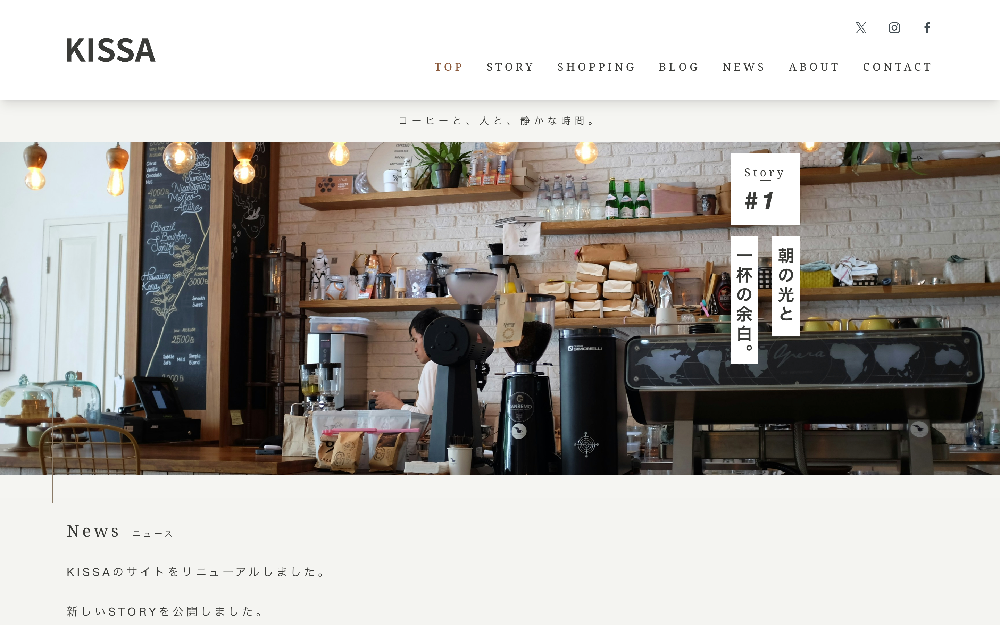
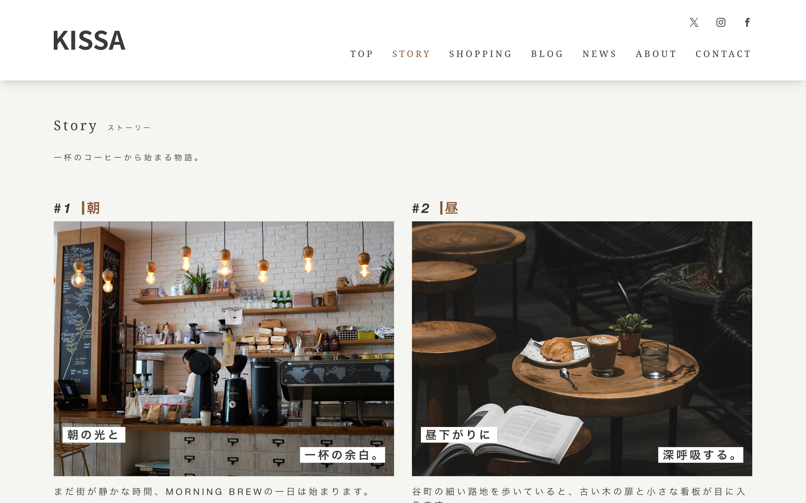
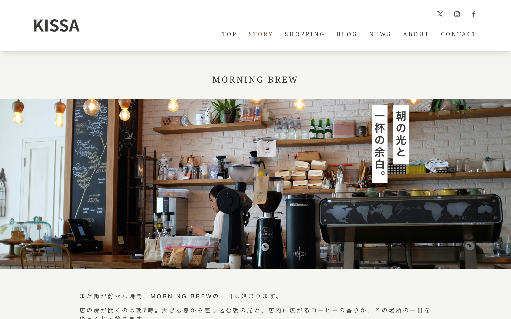
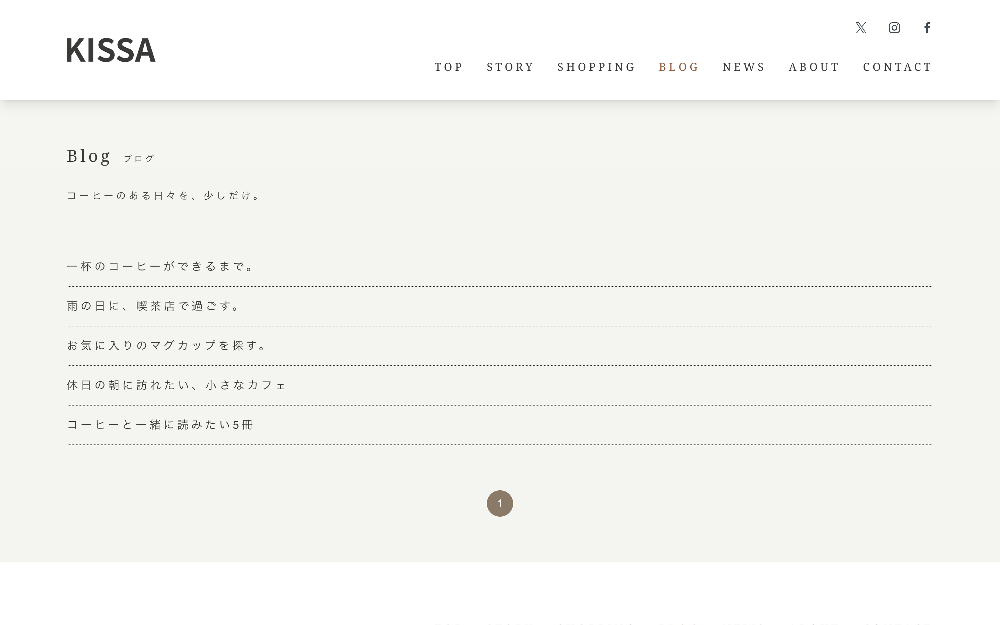
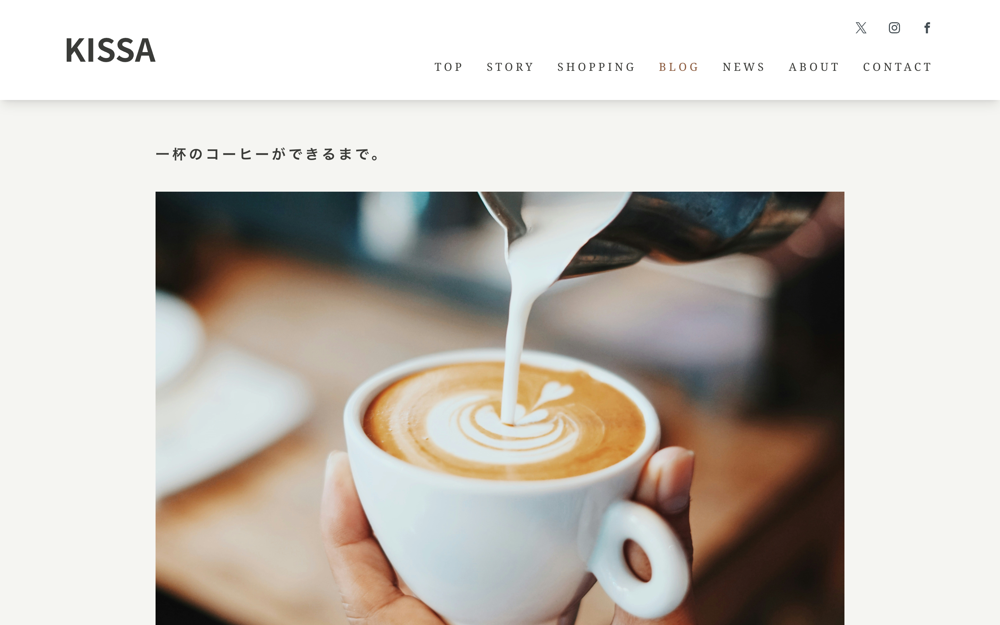
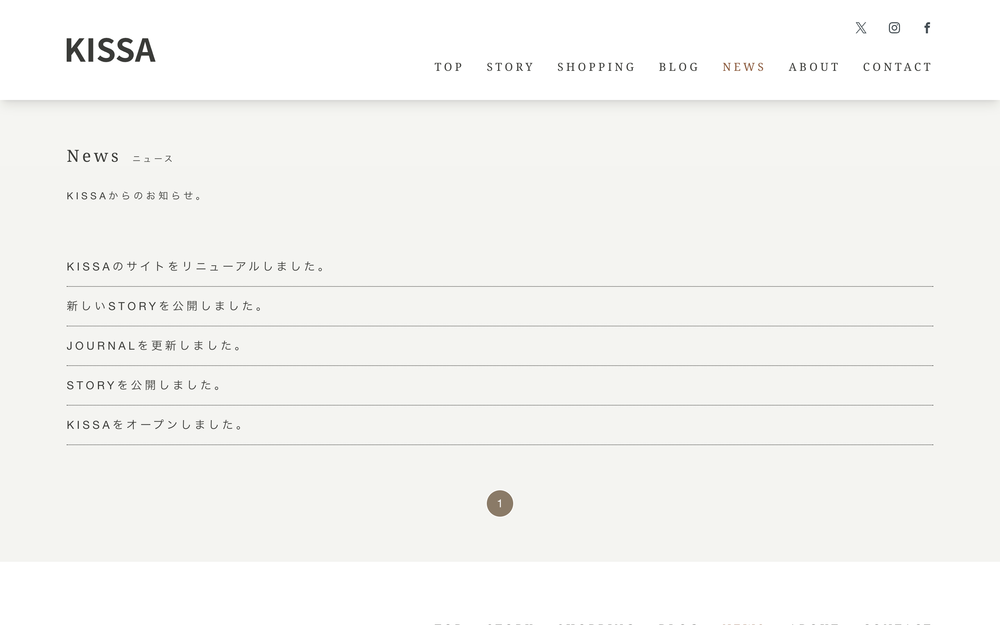
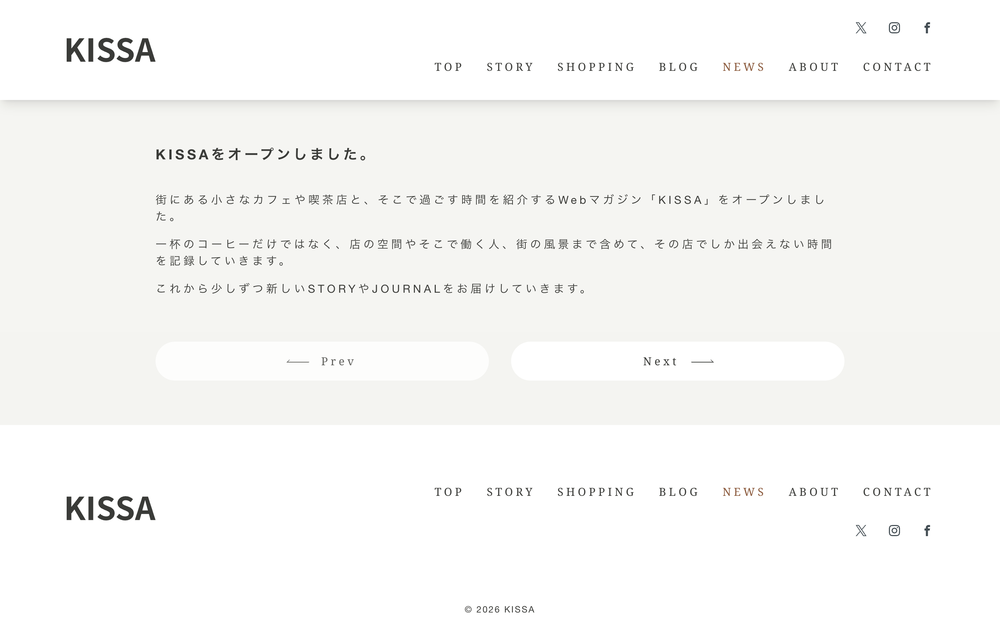
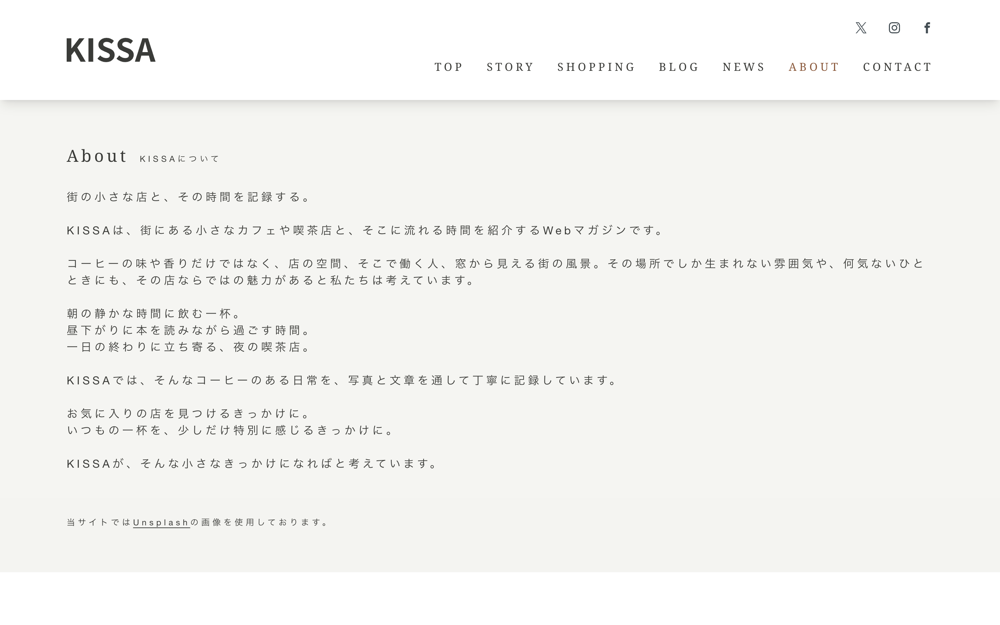
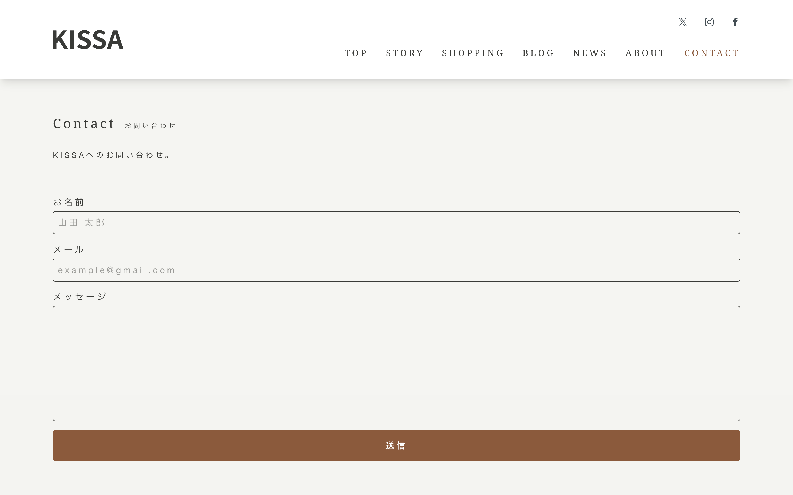
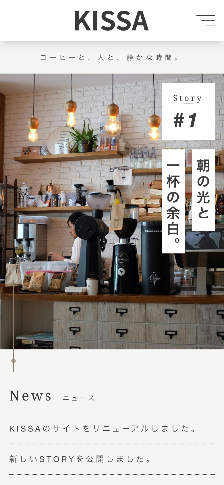

# KISSA

街にある小さなカフェや喫茶店を紹介するWebマガジン。コーヒーと人、店に流れる静かな時間や街の魅力を丁寧に届けます。カフェ巡りの参考に。

## Demo

https://kissa.tw08iwckpyvz48pfu0sx-262.workers.dev

## Screenshots

### Home



### Story



### Story Details



### Blog



### Blog Details



### News



### News Details



### About



### Contact



### Mobile



## Features

- Story・Blog・Newsの記事一覧・詳細表示
- microCMSを利用したヘッドレスCMS構成
- レスポンシブデザイン
- ローディングアニメーション
- スクロールアニメーション
- お問い合わせフォーム
- SEOを意識したメタデータ設定

## Key Implementations

- App Routerによるルーティング構成
- Server Componentsを利用したデータ取得
- microCMSとの連携によるコンテンツ管理
- 共通データをconstantsへ集約し保守性を向上
- コンポーネント指向を意識した設計
- Tailwind CSSによるユーティリティベースのスタイリング
- メタデータ・OGP・robots・sitemapの実装
- アクセシビリティを考慮したHTML設計

## Tech Stack

| Category   | Technology   |
| ---------- | ------------ |
| Framework  | Next.js      |
| Language   | TypeScript   |
| CMS        | microCMS     |
| Styling    | Tailwind CSS |
| Deployment | Vercel       |
| Lint       | ESLint       |
| Formatter  | Prettier     |

### Centralized Configuration

サイト名やメタデータなどの共通情報は`constants`に集約しています。

変更箇所を一元化することで、保守性を向上させています。

### Accessibility

アクセシビリティを意識して実装しています。

- セマンティックなHTML
- 適切な見出し構造
- alt属性の設定
- aria-labelの利用

### UI / Animation

ユーザー体験を向上させるため、過度にならない範囲でアニメーションを採用しています。

- ページ遷移時のローディングアニメーション
- スクロールに応じたフェードインアニメーション
- ホバー時のトランジション

## Getting Started

### Clone the repository

```bash
git clone https://github.com/iotgsdh/kissa.git
cd kissa
```

### Install dependencies

```bash
npm install
```

### Run the development server

```bash
npm run dev
```

Open http://localhost:3000 in your browser.

## Directory Structure

```text
.
├── app
│   ├── about
│   ├── blog
│   ├── contact
│   ├── news
│   ├── shopping
│   └── story
├── components
├── constants
├── contexts
├── hooks
├── libs
└── types
```

| Directory    | Description                                                                                                          |
| ------------ | -------------------------------------------------------------------------------------------------------------------- |
| `app`        | App Routerのページ、レイアウト、ルーティングを管理します。各ページ（about・blog・news・storyなど）を配置しています。 |
| `components` | 再利用可能なUIコンポーネントを配置します。                                                                           |
| `constants`  | サイト情報や共通で使用する定数を管理します。                                                                         |
| `contexts`   | React Contextによる状態管理を行います。                                                                              |
| `hooks`      | カスタムフックを配置します。                                                                                         |
| `libs`       | API通信や共通処理を配置します。                                                                                      |
| `types`      | TypeScriptの型定義を管理します。                                                                                     |
